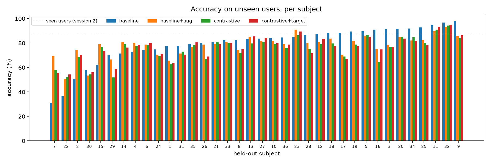
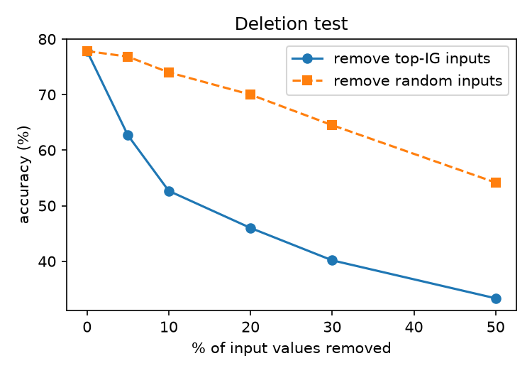
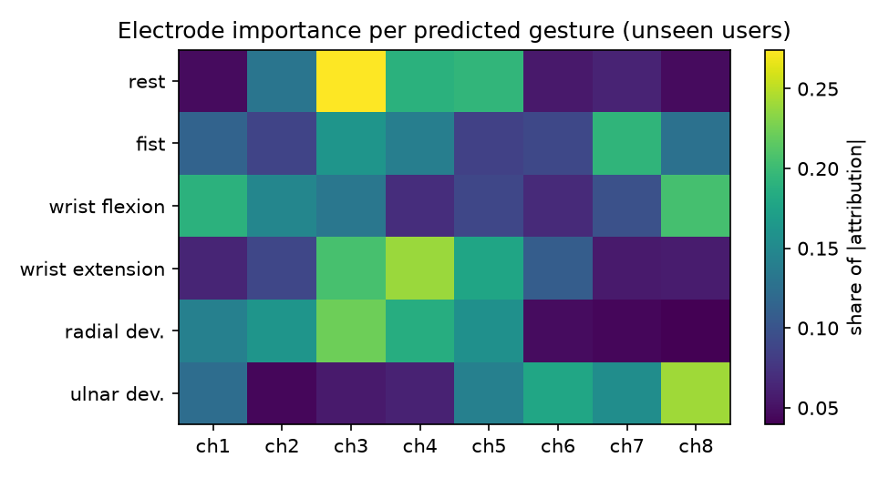

# Cross-user sEMG gesture recognition with contrastive pretraining

Short self-directed study: how much does gesture-recognition accuracy drop on **unseen users**, and does EMG-specific contrastive pretraining (electrode gain, armband rotation, channel dropout, noise, time shift) close the gap? Includes Integrated Gradients attributions with completeness and deletion-test faithfulness checks.

**Data:** UCI *EMG Data for Gestures* (Myo armband, 8 channels, 36 subjects). Downloaded automatically by the notebook.

## Results (full run: 6 folds, 36 subjects, 26,974 one-second windows)

**1. New users are harder, and the average hides who fails.**

| Setting | Accuracy (mean over subjects, 95% bootstrap CI) |
|---|---|
| Seen users, new session | 87.5% [85.1–90.0] |
| Unseen users, CNN baseline | 79.4% [74.3–84.0] |

Per-subject accuracy for unseen users ranges from 98.2% down to 30.9%.

**2. EMG-specific augmentation mainly improves the worst-case user.**

| Unseen users | Mean acc. | Macro-F1 | Std across users | 10th percentile | Worst user | Users < 60% |
|---|---|---|---|---|---|---|
| baseline | 79.4% | 78.0% | 15.4 | 60.1% | 30.9% | 4 |
| baseline + augmentation | 77.9% | 76.4% | 8.9 | 68.0% | 50.7% | 2 |
| contrastive pretraining | 75.3% | 73.3% | 10.2 | 60.2% | 51.8% | 4 |
| contrastive + unlabeled target data | 76.2% | 74.2% | 9.9 | 61.3% | 54.2% | 4 |

Paired differences over subjects (bootstrap 95% CI):
- augmentation vs baseline: −1.5 pts [−4.8, +2.2] (mean not significantly different), with a much tighter spread across users
- contrastive pretraining vs augmentation alone: −2.6 pts [−4.0, −1.3] (pretraining hurt)
- adding unlabeled data from new users to pretraining: +0.9 pts [−0.1, +1.9], better for 21/36 users (small, not significant)

**3. Attributions are faithful.** Integrated Gradients completeness error: 3.2% (median). Deletion test: removing the 10% most-attributed inputs drops accuracy from 77.8% to 52.7%, versus 74.0% when removing 10% at random.

**4. Gestures use distinct electrode groups.** Wrist flexion relies mostly on ch1 and ch8, wrist extension on ch3–5, ulnar deviation on ch6–8 and radial deviation on ch2–5, i.e. opposing movements use opposite sides of the armband.

### Takeaways
- EMG-specific augmentation traded a small, non-significant drop in mean accuracy for a much better worst case (worst user 30.9% → 50.7%; 10th percentile 60.1% → 68.0%).
- Contrastive pretraining on this small dataset did not add value beyond augmentation, consistent with Raftery & Farina (2026), who found pretraining benefits largely vanish on inter-subject splits (see RELATED_WORK.md).

### Limitations
One small public dataset (36 users, 8 channels), a small CNN, no hyperparameter tuning, single seed. Classical feature baselines (e.g. Random Forest on Hudgins features), which are strong on this dataset in the literature, are not yet included.

### Next steps
Classical feature baseline; few-shot per-user calibration; pseudo-label adaptation (as in EMG-UP); subject-adversarial training; using egocentric video as weak supervision for intent.





## Run it
```bash
python3 -m venv .venv && source .venv/bin/activate
pip install -r requirements.txt
```
Then open `notebooks/emg_cross_user_study.ipynb` in VS Code, pick the `.venv` kernel, and Run All.
Set `QUICK=True` in section 1 for a fast smoke test.

## Author
Jahid Hasan Jony · MSc Communications Engineering and Data Science (Erasmus Mundus CODAS)
